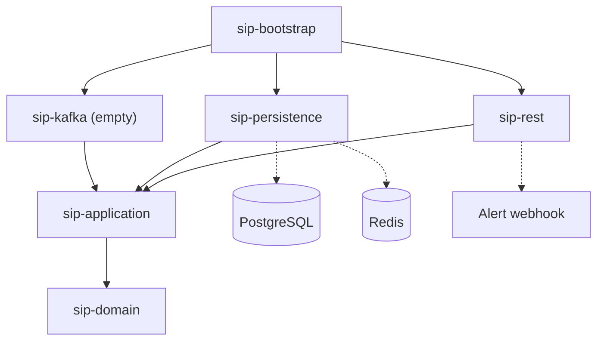

# sip

[](https://github.com/Fede-Berga/sip/actions/workflows/ci.yml)
[](LICENSE)


A Spring Boot 4 service on Java 25 that turns security events from networks, hosts, authentication systems and industrial control systems (ICS) into severity-rated findings, structured as a hexagonal multi-module Gradle build.

The domain model, the use cases and the outbound adapters for PostgreSQL, Redis and an alert webhook exist; no inbound adapter does yet, so a running instance cannot receive events (see [Limitations](#limitations)).

## Quick start

Prerequisites: JDK 25 installed locally and Docker with Compose v2.

```sh
docker compose up -d
./gradlew :sip-bootstrap:bootRun
```

[`docker-compose.yml`](docker-compose.yml) starts PostgreSQL 16, Redis 7, a single-node Kafka broker in KRaft mode and kafka-ui on port 8090; the application uses only PostgreSQL (database, user and password `sip`) and Redis. At startup Liquibase creates the `findings` table, then the server listens on port 8080. From another terminal:

```sh
curl http://localhost:8080/actuator/health
```

The health details include the `db` (PostgreSQL) and `redis` components.

Authentication: the code defines no `SecurityFilterChain`, so Spring Boot's default for an application with Actuator applies: `/actuator/health` is open, everything else needs HTTP Basic or form login. With the OAuth2 resource-server starter on the classpath Boot creates no default `user`, and with no JWT issuer configured bearer tokens are not accepted either, so with the shipped [`application.yml`](sip-bootstrap/src/main/resources/application.yml) nothing can authenticate. To call the other Actuator endpoints (`info`, `metrics`) locally, define a user at startup:

```sh
./gradlew :sip-bootstrap:bootRun --args='--spring.security.user.name=dev --spring.security.user.password=dev'
curl -u dev:dev http://localhost:8080/actuator/metrics
```

`docker compose down -v` removes the containers and their volumes, including the database.

## Architecture



Solid arrows are Gradle dependencies, all pointing towards `sip-domain` (the direct edges to `sip-domain`, and from `sip-bootstrap` to `sip-application`, are omitted); dotted arrows are runtime connections.

| Module | Responsibility |
| --- | --- |
| `sip-domain` | Events, findings and severity levels (records and enums) and the outbound ports `FindingStoragePort`, `EventCachePort` and `AlertPort`. No dependencies. |
| `sip-application` | The use cases `IngestEventUseCase`, `CorrelateEventsBatchUseCase` and `QueryFindingsUseCase` and the rule-based `CorrelationEngine`, in plain Java; in-memory fakes of the ports as test fixtures. |
| `sip-persistence` | `JpaFindingAdapter` (Spring Data JPA on PostgreSQL), `RedisEventCacheAdapter` and the Liquibase changelogs. |
| `sip-rest` | `WebhookAlertAdapter` on Spring's `RestClient`; the Spring Security and OAuth2 resource-server dependencies. No controllers yet. |
| `sip-kafka` | Declares `spring-kafka`; no code yet. |
| `sip-bootstrap` | The Spring Boot application: wires the use cases in [`ApplicationConfig`](sip-bootstrap/src/main/java/dev/sip/ApplicationConfig.java), runs Liquibase, exposes Actuator. |

`IngestEventUseCase` handles one event in four steps:

1. **Deduplication.** `EventCachePort.markSeenIfNew` with a five-minute TTL: the Redis adapter sets the key `sip:event:<source IP>:<event type>` only if it is absent, so a repeat within the window is dropped.
2. **Correlation.** `CorrelationEngine` tries the 13 rules in [`CorrelationRules`](sip-application/src/main/java/dev/sip/application/CorrelationRules.java) in order; the first match sets the rule ID and severity. A failed SSH login is `AUTH_BRUTE_FORCE` (CRITICAL), an inbound connection to port 22 is `NET_SSH_INBOUND` (HIGH), an ICS reading above its tag's threshold (TEMP 90, PRESSURE 150, VOLTAGE 480) is `ICS_THRESHOLD_EXCEEDED` (HIGH). Each event type ends with a catch-all rule.
3. **Storage.** `FindingStoragePort.save`: the JPA adapter maps the finding to a `findings` row, with the type-specific event fields as JSON in the `jsonb` column `event_payload`.
4. **Alerting.** HIGH and CRITICAL findings go to `AlertPort.send`; the webhook adapter POSTs a JSON summary to `sip.alerts.webhook-url`. That URL is empty by default, and then the alert is only logged; failed deliveries are logged, not retried.

`CorrelateEventsBatchUseCase` runs `ingest` for each event of a batch on its own virtual thread. `QueryFindingsUseCase` reads findings by ID, all at once, or by minimum severity since a given instant.

## Running the tests

```sh
./gradlew test
./gradlew :sip-application:test
./gradlew :sip-application:test --tests 'dev.sip.application.CorrelationEngineTest'
```

These run every test, one module's tests and one test class. All tests are in `sip-application` and run the rules and the ingest flow against the in-memory fakes, so they need no Docker, database or broker.

The root [`build.gradle.kts`](build.gradle.kts) sets a Java 25 toolchain and adds `--enable-preview` to every compile, test and `JavaExec` task, so Gradle needs no extra flags; running the application outside Gradle, from an IDE or as a jar, needs `--enable-preview` too. CI runs `./gradlew build` on Temurin 25 for every push to `main` and every pull request.

## Design decisions

- **Hexagonal layout.** `sip-domain` has no dependencies and the use cases get their ports through constructors, so the tests run them against fakes without Spring or containers. Only `sip-bootstrap` sees every module; swapping an adapter, such as the webhook, leaves the use cases untouched.
- **Closed event model.** `EventType` is a sealed interface over four records, one per event source, which the rules match with pattern matching for `instanceof`.
- **PostgreSQL with Liquibase.** Findings are rows indexed on severity, detection time and status; the variable part of an event goes into one `jsonb` column instead of a table per event type. Schema changes are versioned changelogs.
- **Redis for deduplication.** A conditional set with an expiry checks and marks an event in one atomic step, the window ends without a cleanup job, and every instance connected to the same Redis shares it.
- **Webhook alerts.** A JSON POST works with any receiver that accepts webhooks, and it stays off until a URL is set.
- **Virtual threads.** Enabled for request handling (`spring.threads.virtual.enabled`) and used by the batch use case, since ingesting an event mostly waits on Redis, PostgreSQL and the webhook.

## Limitations

- No inbound adapter: no REST controller and no Kafka consumer, so the only HTTP endpoints are Actuator's. The `spring.kafka` settings and the Kafka containers are unused.
- Rules see one event at a time, with no correlation across events or time windows: a single failed SSH login is already `AUTH_BRUTE_FORCE`, and any inbound connection to a port below 1024 other than 22 is `NET_PORT_SCAN`.
- Deduplication keys on source IP and event type only, so within five minutes another event of the same type from the same address, such as a different user's failed login, is dropped too.
- Only the source IP and the type-specific event fields are stored; a finding read back gets a new event ID and timestamp, without the raw payload or metadata.
- Security is Spring Boot's default, as described in the quick start.
- The JPA, Redis and webhook adapters have no tests.

## License

MIT, see [LICENSE](LICENSE).
